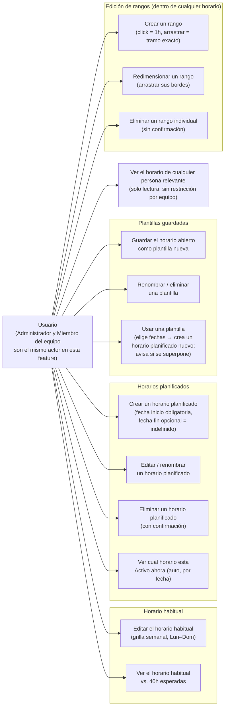

# Tasks Weekly Availability — Planned Schedules & Templates Design Notes

**Status:** Draft — captures prototype behavior, not yet approved scope

**Source:** Iterative Codex-built HTML prototypes (throwaway mockups), driven by live product-owner feedback in a single working session, 2026-10-30

**Prototype files (reference, not shipped code):**
- `weekly-availability-grid-prototype.html` — team/admin view
- `my-availability-plans-prototype.html` — non-admin self-service view

**Builds on:** `docs/superpowers/specs/2026-10-09-task-availability-design.md` (approved spec for Delivery 1) and the Delivery 2/3 sketch in `docs/superpowers/plans/2026-10-20-task-weekly-availability.md`

## 1. Purpose

Through this prototyping session the product owner pushed well past Delivery 1's single-recurring-schedule model toward something close to the original spec's Delivery 2 ("Weekly Exceptions and Advance Planning"), plus several concepts the original spec never named. This document captures what was actually built, as a Mermaid use-case diagram and a plain description, and separately lists the gaps and open questions found while reading the code — so these can be triaged (confirmed, fixed, or explicitly deferred) before any of this becomes committed scope.

This is **not** an approved specification. It is a snapshot of a prototype for review.

## 2. Vocabulary introduced in this session

| Term | Meaning |
|---|---|
| **Horario actual** (current schedule) | Whatever is in effect right now — either the habitual schedule or an active plan overriding it. Not a separate stored entity; it's a computed state. |
| **Horario habitual** (habitual schedule) | The one typical recurring week (Monday–Sunday, repeats forever). Every user has exactly one. |
| **Horario planificado** (planned schedule / plan) | A date-bound override: a start date (required) and an end date (optional — absent means "indefinido," active until another plan supersedes it). While its range covers today, it governs instead of the habitual schedule; the habitual schedule resumes automatically once the plan ends or is superseded. |
| **Plantilla guardada** (saved template) | A reusable, date-less snapshot of a week. Has no effect on its own. "Usar" converts it into a new planned schedule by asking the user to pick dates — it never changes what's currently active by itself. |

## 3. Actors

**As of this session, there is only one actor for this feature.** Earlier drafts of this document distinguished Administrador from Miembro del equipo (admin reads all relevant teammates, a regular member reads only same-team). Wagner reversed that explicitly during this session: reads are now **org-wide for every user**, not team-scoped, and he confirmed directly (asked as an explicit either/or) that Administrador should become **fully identical** to Miembro del equipo in this feature — no distinguishing capability left, by his own choice, not an oversight.

- **Usuario** (any team member, admin or not): manages their own habitual schedule, planned schedules, and templates, and can view every relevant person's current schedule read-only. Role plays no part in what this feature allows.

This reverses §4.5 ("Permissions") of the originally approved Delivery 1 spec, which recorded same-team read for regular members and read-all for admin as a deliberate decision (see that spec's own §15 Decision Record: "Team visibility | Team members may read their team; administrators may read all relevant schedules..."). That reversal is intentional and owner-approved, made live in this session — not a drift to carry forward silently. Whoever reconciles this document with the approved spec should treat §4.5/§15 there as superseded by this decision, not simply out of sync with it.

## 4. Use-case diagram

All thirteen use cases belong to the single Usuario actor identically — there is no role-based split left to show. UC13 has no scope distinction anymore: reads are org-wide for everyone, not same-team-only for a regular member.

## 5. Interaction architecture: modal-only, unified for self and teammate viewing

This repo's own codebase was checked directly, not assumed. Dynamic page routes (`src/app/.../[id]`) are the rare exception — exactly one exists in the whole app, `src/app/(app)/meetings/[id]` — while modal components for "view or edit one record's detail" are the dominant, established pattern across several features: `PacientesImportModal` (medical), `CampaignViewModal`/`LeadFormModal`/`LeadImportModal`/`EmailCountModal`/`TitleMatchModal` (research), `ActivityDetailModal`/`NewActivityModal` (tasks). Meanwhile, the currently-shipped real app (Delivery 1, already in production) uses a *third* pattern for this one feature: inline expand/collapse in the team list — click your own card's pencil, the editor mounts in place, replacing your card in the list. That inline pattern is reasonable for small content (a handful of fields) but doesn't fit the now much larger self-service content (habitual + planned schedules + templates, each with their own grid editor): every other card in the list reflows awkwardly when it opens, and it can't give the focused-task feel a modal gives.

**Decision:** standardize on one interaction for viewing or editing any person's schedule. Click their card; a modal opens with the same content component. It's editable only if it's your own schedule — anyone else's opens the identical modal and component, always read-only, never a second code path. This replaces the real app's current inline-expand pattern (a real migration of already-shipped Delivery 1 UI, not just new work on top of it) and avoids introducing a second new pattern (a dynamic route) that would create exactly the kind of inconsistency this repo already has in `meetings/[id]`.

**There is no role-based card filtering anymore.** An earlier draft of this document described a restricted, same-team-only card list for a regular member versus an org-wide list for admin. That restriction no longer exists (§3): every user's card list shows every relevant person, full stop. The modal-click mechanism was already identical for every actor; now the visible card set is identical too, so there is nothing left that varies by role in this feature.

## 6. Gaps and open questions

Each item below was verified against the actual prototype code, not assumed. Two items from an earlier pass of this document turned out to be stale — the features had since landed — and are corrected below, with the line references that confirm it.

1. **The teammate viewer does not know about plans or templates — now resolved by the architecture decision above, but not yet reflected in the prototype.** `memberRanges(memberId)` for any person other than the logged-in user still returns a flat `saved`/`draft` ranges array (`weekly-availability-grid-prototype.html`, `memberSchedules` + `memberRanges`), with no concept of that person's own active plan overriding their habitual schedule. Per §5's decision, the real fix isn't a separate viewer code path at all — it's the *same* self-service component, opened read-only, for anyone looking at anyone. The prototype's current viewer predates that decision (and predates org-wide reads — it was still admin-gated) and still needs to be rebuilt on top of both, rather than patched in place.

2. **"Planned schedules use real calendar dates instead of repeating weekday columns" — implemented, confirmed by reading the code.** Both files generate real per-date columns for a plan's editor specifically: `calendarDays(start, end)` (`weekly-availability-grid-prototype.html:868`, `my-availability-plans-prototype.html:447`) walks every calendar day from `startDate` to `endDate` inclusive (or, with no end date, defaults to a 7-day span) and returns one entry per real date, each carrying its own ISO date, formatted label, and weekday name — not a repeating weekday pattern. `isCalendarEditor()` (`weekly-availability-grid-prototype.html:804`, `my-availability-plans-prototype.html:721`) gates this to plans only (habitual and templates keep the generic 7-column Monday–Sunday grid), and `editorDays()` / `editorDateChanged()` re-render the grid live as the start/end date fields change. A two-week plan does correctly let week 1 and week 2 differ — confirmed, not just claimed.

3. **"Auto-snapshot the habitual schedule as a template when it changes" — implemented, confirmed by reading the code.** In both files, the habitual save path checks whether the ranges about to be overwritten actually differ from what's being saved, and if so pushes a new template built from the *prior* ranges, named `'Horario habitual — ' + formatPlanDate(replacementDate())`, before committing the new ranges (`weekly-availability-grid-prototype.html:1530-1539`; `my-availability-plans-prototype.html:781-786`, `meta: 'Guardada automáticamente'`). No snapshot is created when nothing actually changed (reuses the existing dirty-check), matching what was asked for.

4. **What happens to a deleted plan/template if it's currently active?** Deleting a plan or template goes through a confirmation modal that unconditionally removes the entry (`deletePromptConfirm` handlers in both files) and then just re-renders. If the deleted entry was the one currently "Activo ahora," the system falls back to whatever `activePlan()` recomputes next — in practice, the habitual schedule, since the deleted plan is simply gone from the `plans`/`state.plans` array. This isn't broken, but it's also not explicitly surfaced to the user in the confirmation copy ("¿Eliminar «X»? Esta acción no se puede deshacer." doesn't mention that deleting an *active* plan immediately changes what the team sees as this person's current schedule).

5. **Superseding an indefinite-end plan doesn't change its own data, which is a deliberate and sound choice, but is subtle.** When a new plan is activated while a previous open-ended plan is active, `planPhase()` computes the old plan's status as `'replaced'` by checking whether a *later-added* plan's start date has arrived — the superseded plan's own `endDate` stays `null` forever; it's the phase-computation function, not the data, that marks it inactive (`nextPlanAfter()` in both files, confirmed by reading the comment "A later plan supersedes an open-ended one permanently, even after it ends. Keep endDate null"). This is a reasonable modeling choice (the data stays honest: "I never got an end date, something else just started") but it means a `'replaced'` plan's own card will say "sin fecha de fin" (no end date) while also saying "Reemplazado desde el \<date\>" — worth confirming this reads clearly rather than as a contradiction once this leaves prototype stage.

6. **The auto-generated template name does not collide with the reserved-name check — verified, now that gap 3 above is confirmed built.** The reserved-name check (`validateEditorName`, both files) rejects only an exact case-insensitive match to "mi horario habitual" / "horario habitual"; the auto-generated name `'Horario habitual — ' + formatPlanDate(...)` always carries the em dash and a date, so it never matches exactly. No fix needed here.

7. **Activation is driven by a hardcoded demo date, not a real clock.** Both files define `var DEMO_TODAY = '2024-10-22'` (or equivalent) and every activation/phase computation (`planPhase`, `activePlan`) compares against that fixed string, never `new Date()`. This is correct and intentional for a demo (the comment in the code says so explicitly: "Freeze this demo on Tuesday; never use the machine clock for activation"), but the real implementation must replace this with the actual current date in the server's or user's relevant timezone — this app uses `America/Guayaquil` elsewhere (per this repo's `CLAUDE.md` and the date-formatting calls already in these prototypes, e.g. `toLocaleString('es-EC', { timeZone: 'America/Guayaquil', ... })`).

8. **Overlap detection only looks at plans, never at the habitual schedule itself** — which is correct, since the habitual schedule has no date range to overlap with, but means a user could create two plans whose ranges overlap *each other's dates* without warning if the second one is created through "+ Planificar un horario puntual" directly rather than through "Usar" on a template (`overlappingPlans()` is only called from the template-use flow, `updateTemplateUseState()`, not from the direct new-plan path, `newPlanBtn`'s handler). Worth deciding whether direct plan creation should get the same overlap check.

9. ~~Neither prototype demonstrates a regular (non-admin) member's restricted, same-team-only view of teammates.~~ **Moot — resolved by §3's decision.** There is no restricted view left to demonstrate: reads are org-wide for every user now, so this stopped being a gap the moment the underlying restriction was removed, not because it was fixed.

## 7. Reuse analysis: what exists in the codebase already

Checked directly against the real codebase (not assumed) before treating the grid-canvas work as net-new.

**No reusable grid/canvas component exists.** Two existing calendar-shaped components were ruled out:
- `src/features/tasks/components/calendar/CalendarTab/index.tsx` (the "Calendario" tab) — a day-*cell* month/week calendar for date-only items (`Task.fecha_entrega`, `Marker.start_date`/`target_date`). No hour axis, no drag, read-only apart from navigation and selection.
- `src/shared/components/views/CalendarView/` (the shared calendar primitive; its only consumer is `BillingCalendar`) — same shape: `CalendarItem.date` is documented as a date-only ISO string, `CalendarMode` only supports `'month'`, and its prop contract has no create/drag callbacks at all.

**The real reuse opportunity is the data layer, not a UI component.** `WeeklyAvailabilityEditor` — already shipped in Delivery 1, `src/features/tasks/components/solicitudes/WeeklyAvailabilityEditor/` — has exactly the right domain model: weekday + start/end time + overlap validation (`src/features/tasks/utils/availability/`), the transport types (`src/features/tasks/data/availability/types.ts`), and the API route (`src/app/api/tasks/availability/route.ts`). But it's a plain form — native `<input type="time">` pairs in a vertical list via `RangeField`/`DaySection` — not a visual grid. That data/API/validation layer is directly reusable for the grid-canvas feature; the grid itself (day columns × hour rows, click/drag-to-create, drag-to-resize, confirm popover) has no precedent anywhere in `src/` and would need to be built from scratch, including the pixel↔time math, snapping, and drag/resize pointer handling already validated in the throwaway prototypes.

One dead-code find worth a note so it isn't rediscovered later: `HourSlot` (`src/features/tasks/components/solicitudes/HourSlot/index.tsx`) sounds relevant by name but has zero imports anywhere in the codebase — orphaned, not a usable building block.

## 8. Delivery mapping

**Maps to the original spec's Delivery 2 scope** ("plan a different schedule for a specific week," "distinguish the recurring template from an override," "return to the recurring schedule when no override applies"):
- Planned schedules (date-bound, auto-activating, auto-reverting)
- Multiple planned schedules existing at once, with one active at a time

**Goes beyond Delivery 2 as originally written — invented during this prototyping session, not yet signed off as committed scope:**
- The reusable, date-less "template" concept and its "Usar → pick dates → becomes a plan" conversion flow
- Auto-snapshotting the habitual schedule as a template on change (built, see gap 3)
- Calendar-date (not repeating-weekday) editing for plans (built, see gap 2)
- Indefinite/open-ended plan end dates with implicit supersession by a later plan
- Weekend (Saturday/Sunday) columns in the grid — the real domain model already allowed this (ISO weekdays 1–7), but the original spec's examples and UI sketch were Mon–Fri only
- Modal-only interaction, unified for self and teammate viewing, replacing Delivery 1's shipped inline-expand editor (§5) — a real migration of existing production UI, not additive work
- Org-wide read access for every user, replacing same-team-only reads for regular members (§3) — a direct reversal of §4.5/§15 of the originally approved Delivery 1 spec, which recorded same-team read as a deliberate decision, not a default. **Already signed off** — Wagner confirmed this explicitly in this session, including the follow-up question of whether admin should keep any distinguishing capability (answer: no, fully identical). Still flagged here because it contradicts a previously *recorded* decision in the approved spec, and that spec itself hasn't been amended to match — whoever reconciles this document with it needs to update §4.5/§15 there, not just treat this document as the newer source of truth by default.

Everything in the second list should get the product owner's explicit go-ahead before being treated as scope for any delivery, rather than carried forward by prototyping momentum alone. The org-wide-reads item already has that go-ahead; the rest do not yet.
