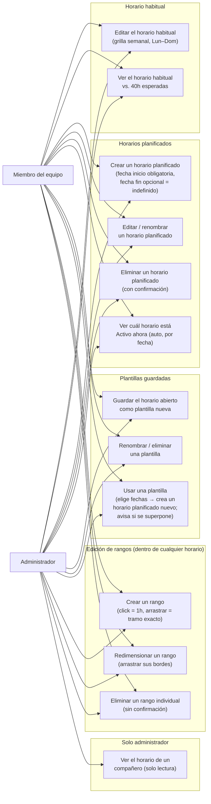

# Tasks Weekly Availability — Planned Schedules & Templates Design Notes

**Status:** Draft — captures prototype behavior, not yet approved scope

**Source:** Iterative Codex-built HTML prototypes (throwaway mockups), driven by live product-owner feedback in a single working session, 2026-10-30

**Prototype files (reference, not shipped code):**
- `weekly-availability-grid-prototype.html` — team/admin view
- `my-availability-plans-prototype.html` — non-admin self-service view

**Builds on:** `docs/superpowers/specs/2026-10-09-task-availability-design.md` (approved spec for Delivery 1) and the Delivery 2/3 sketch in `docs/superpowers/plans/2026-10-20-task-weekly-availability.md`

## 1. Purpose

Through this prototyping session the product owner pushed well past Delivery 1's single-recurring-schedule model toward something close to the original spec's Delivery 2 ("Weekly Exceptions and Advance Planning"), plus several concepts the original spec never named. This document captures what was actually built, as a Mermaid use-case diagram and a plain description, and separately lists the gaps and open questions found while reading the code — so these can be triaged (confirmed, fixed, or explicitly deferred) before any of this becomes committed scope.

This is **not** an approved specification. It is a snapshot of a prototype for review.

## 2. Vocabulary introduced in this session

| Term | Meaning |
|---|---|
| **Horario actual** (current schedule) | Whatever is in effect right now — either the habitual schedule or an active plan overriding it. Not a separate stored entity; it's a computed state. |
| **Horario habitual** (habitual schedule) | The one typical recurring week (Monday–Sunday, repeats forever). Every user has exactly one. |
| **Horario planificado** (planned schedule / plan) | A date-bound override: a start date (required) and an end date (optional — absent means "indefinido," active until another plan supersedes it). While its range covers today, it governs instead of the habitual schedule; the habitual schedule resumes automatically once the plan ends or is superseded. |
| **Plantilla guardada** (saved template) | A reusable, date-less snapshot of a week. Has no effect on its own. "Usar" converts it into a new planned schedule by asking the user to pick dates — it never changes what's currently active by itself. |

## 3. Actors

Two actors use this feature. **Administrador is not a separate, more restricted role** — an admin gets every self-service capability a regular team member gets for their own schedule, plus one additional capability: read-only oversight of teammates' schedules.

- **Miembro del equipo** (regular team member): manages only their own habitual schedule, planned schedules, and templates.
- **Administrador**: everything above, for their own schedule, *plus* read-only viewing of every relevant teammate's current schedule.

## 4. Use-case diagram

Shared use cases (UC1–UC12) belong to both actors identically — an admin's own schedule works exactly like a regular member's. UC13 is admin-only, additive, and read-only.

## 5. Gaps and open questions

Each item below was verified against the actual prototype code, not assumed.

1. **The admin's teammate viewer does not know about plans or templates.** `memberRanges(memberId)` for any teammate other than the logged-in user returns a flat `saved`/`draft` ranges array (`weekly-availability-grid-prototype.html`, `memberSchedules` + `memberRanges`) — there is no concept of a teammate's own active plan overriding their habitual schedule in this view. An admin currently cannot tell whether what they're looking at for a teammate is that person's habitual schedule or a plan currently overriding it, because the viewer was built before plans/templates existed and was never updated for them. **This needs a real decision**, not just a prototype fix: does the real implementation need to resolve each teammate's own active-plan-vs-habitual the same way the self-service view does?

2. **"Planned schedules use real calendar dates instead of repeating weekday columns" was requested but is not implemented.** Both prototype files still render every editor (habitual, plan, or template) against the same fixed Monday–Sunday weekday grid (`DAYS` array, reused unconditionally in `renderGrid()` in both files). A plan's `startDate`/`endDate` are stored and used for activation logic (see below) but never change what the grid shows — a two-week plan cannot currently have week 1 look different from week 2, which was explicitly asked for. This is the single largest gap between stated intent and actual behavior found in this review.

3. **"Auto-snapshot the habitual schedule as a template when it changes" was requested but is not implemented.** The habitual schedule's save handler (`weekly-availability-grid-prototype.html`, the `saveBtn` click listener) just closes the modal with `save: true` and commits the edit — no new template is created. Nothing in either file auto-generates a template from a prior habitual version.

4. **What happens to a deleted plan/template if it's currently active?** Deleting a plan or template goes through a confirmation modal that unconditionally removes the entry (`deletePromptConfirm` handlers in both files) and then just re-renders. If the deleted entry was the one currently "Activo ahora," the system falls back to whatever `activePlan()` recomputes next — in practice, the habitual schedule, since the deleted plan is simply gone from the `plans`/`state.plans` array. This isn't broken, but it's also not explicitly surfaced to the user in the confirmation copy ("¿Eliminar «X»? Esta acción no se puede deshacer." doesn't mention that deleting an *active* plan immediately changes what the team sees as this person's current schedule).

5. **Superseding an indefinite-end plan doesn't change its own data, which is a deliberate and sound choice, but is subtle.** When a new plan is activated while a previous open-ended plan is active, `planPhase()` computes the old plan's status as `'replaced'` by checking whether a *later-added* plan's start date has arrived — the superseded plan's own `endDate` stays `null` forever; it's the phase-computation function, not the data, that marks it inactive (`nextPlanAfter()` in both files, confirmed by reading the comment "A later plan supersedes an open-ended one permanently, even after it ends. Keep endDate null"). This is a reasonable modeling choice (the data stays honest: "I never got an end date, something else just started") but it means a `'replaced'` plan's own card will say "sin fecha de fin" (no end date) while also saying "Reemplazado desde el \<date\>" — worth confirming this reads clearly rather than as a contradiction once this leaves prototype stage.

6. **The auto-generated template-name collision case doesn't exist, because the auto-snapshot feature itself doesn't exist (see #3).** No further gap here beyond #3 — flagging so it isn't lost when #3 is implemented: whatever auto-naming scheme is chosen must still pass the existing reserved-name check (`validateEditorName`, which rejects "mi horario habitual" / "horario habitual" case-insensitively).

7. **Activation is driven by a hardcoded demo date, not a real clock.** Both files define `var DEMO_TODAY = '2024-10-22'` (or equivalent) and every activation/phase computation (`planPhase`, `activePlan`) compares against that fixed string, never `new Date()`. This is correct and intentional for a demo (the comment in the code says so explicitly: "Freeze this demo on Tuesday; never use the machine clock for activation"), but the real implementation must replace this with the actual current date in the server's or user's relevant timezone — this app uses `America/Guayaquil` elsewhere (per this repo's `CLAUDE.md` and the date-formatting calls already in these prototypes, e.g. `toLocaleString('es-EC', { timeZone: 'America/Guayaquil', ... })`).

8. **Overlap detection only looks at plans, never at the habitual schedule itself** — which is correct, since the habitual schedule has no date range to overlap with, but means a user could create two plans whose ranges overlap *each other's dates* without warning if the second one is created through "+ Planificar un horario puntual" directly rather than through "Usar" on a template (`overlappingPlans()` is only called from the template-use flow, `updateTemplateUseState()`, not from the direct new-plan path, `newPlanBtn`'s handler). Worth deciding whether direct plan creation should get the same overlap check.

## 6. Delivery mapping

**Maps to the original spec's Delivery 2 scope** ("plan a different schedule for a specific week," "distinguish the recurring template from an override," "return to the recurring schedule when no override applies"):
- Planned schedules (date-bound, auto-activating, auto-reverting)
- Multiple planned schedules existing at once, with one active at a time

**Goes beyond Delivery 2 as originally written — invented during this prototyping session, not yet signed off as committed scope:**
- The reusable, date-less "template" concept and its "Usar → pick dates → becomes a plan" conversion flow
- Auto-snapshotting the habitual schedule as a template on change (not yet built, see gap #3)
- Calendar-date (not repeating-weekday) editing for plans (not yet built, see gap #2)
- Indefinite/open-ended plan end dates with implicit supersession by a later plan
- Weekend (Saturday/Sunday) columns in the grid — the real domain model already allowed this (ISO weekdays 1–7), but the original spec's examples and UI sketch were Mon–Fri only

Everything in the second list should get the product owner's explicit go-ahead before being treated as scope for any delivery, rather than carried forward by prototyping momentum alone.
